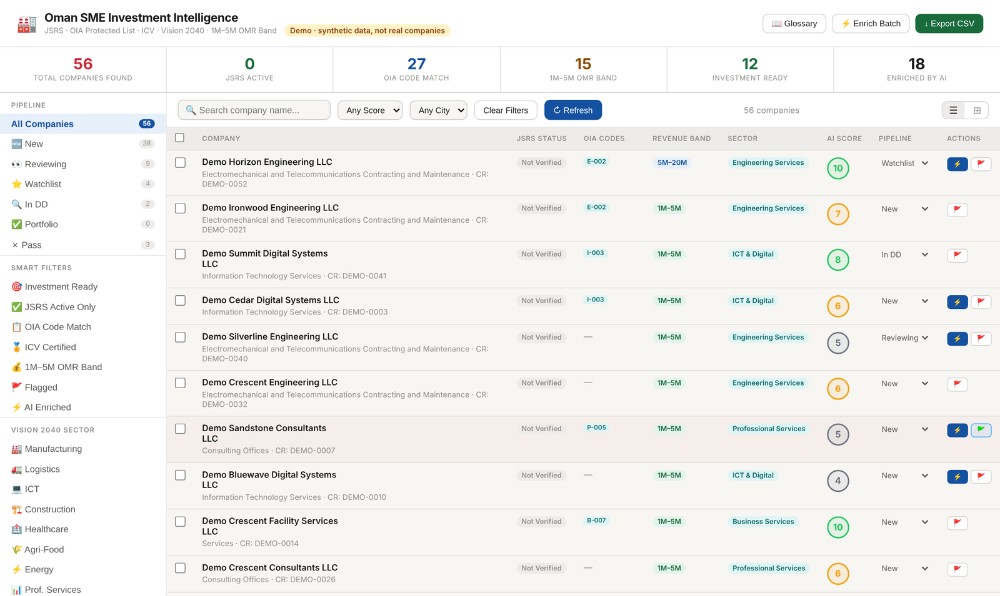
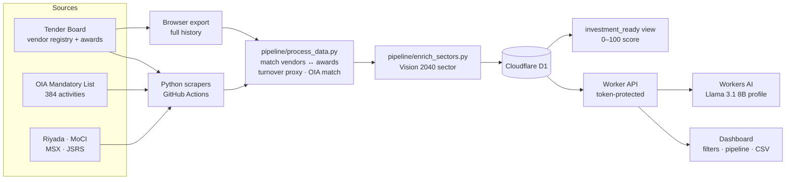

# Oman SME Investment Intelligence

[](../../actions/workflows/tests.yml)

A data pipeline that sources and scores **private Omani SMEs** as investment or acquisition targets. Private SMEs in Oman publish no accounts, so the system builds a turnover proxy from **public government procurement records** and ranks companies against an investor's criteria:

- turnover of **OMR 1M–5M**
- activity on the **OIA Mandatory List**: 384 products and services that must be procured locally, which makes these companies In-Country Value (ICV) beneficiaries
- **JSRS** supplier certification
- alignment with an **Oman Vision 2040** sector

I built it in April 2026 for a private investment client sourcing ICV-aligned SME targets in Oman. It ran on Cloudflare's free tier, with scrapes twice a week, until October 2026. The engagement has since ended and the live deployment has been retired. This repository keeps the code, the methodology and a working demo.

**[Try the dashboard](https://sudiptjethro.github.io/oman-sme-intelligence/)**. It runs in demo mode on synthetic data, so every company shown there is invented.



## Results from the live run (April–October 2026)

| Stage | Companies |
|---|---|
| Tender Board vendors and award records processed | ~20,000 vendors, ~20,000 awarded tenders |
| Companies in the database | 19,608 |
| Registered activity matches the OIA Mandatory List | 4,493 |
| Government contract total in the OMR 1M–5M band | 447 |
| **Investment-ready** (target band, 2+ contracts, current registration) | **131** |
| Profiled by Workers AI | 119 |

The pipeline narrowed a registry of about 20,000 suppliers to a shortlist of about 130 companies that an analyst could review by hand.

## How it works



1. **Collect.** The full Tender Board history (about 20,000 vendors and 20,000 awarded tenders) was exported from the Tender Board's public report pages in a browser session, using a short script run from the Chrome DevTools Console. It paged through each report at a gentle pace, saved progress so it could resume, and downloaded JSON files for the Python pipeline. The export scripts aren't published; the method and the file format the pipeline expects are described in **[docs/data-collection.md](docs/data-collection.md)**. Python scrapers, run from GitHub Actions, add the OIA Mandatory List PDF and supplementary directories (Riyada, Ministry of Commerce, the MSX Growth Market, JSRS public search).
2. **Estimate size.** Total OMR won in government contracts since 2019 stands in for turnover. It's bucketed into revenue bands, with a confidence level based on the number of contracts.
3. **Match policy lists.** Each company's registered category is matched against the OIA protected activities. Its contract buyers and name map it to a Vision 2040 sector.
4. **Score.** A SQL view ranks qualifying companies from 0 to 100: size (35), OIA alignment (30), recent awards (20), contract frequency (15). Shortlisted companies get a Workers AI profile with a score, summary, growth signals and risk flags.
5. **Work the pipeline.** Analysts filter, flag, move companies through stages (New → Reviewing → Watchlist → In DD) and export CSVs.

The reasoning behind the proxy, the score and its limitations is in **[docs/methodology.md](docs/methodology.md)**.

## Repository

```
scrapers/            Python source adapters (Tender Board, OIA list, Riyada, MoCI, MSX, JSRS)
run_scrapers.py      entry point for the Python scrapers (used by GitHub Actions)
pipeline/
  process_data.py    vendor ↔ award matching, turnover proxy, OIA alignment
  enrich_sectors.py  Vision 2040 sector and pillar mapping
  generate_oia_sql.py  OIA protected codes and ICV flags
  load_to_d1.py      bulk loader (wrangler)
schema.sql           D1 schema and the investment_ready scoring view
worker/index.js      Cloudflare Worker: leads, stats, tenders, CSV export, AI enrichment
docs/                dashboard (index.html), synthetic demo data, methodology, data collection
scripts/             demo-data generator
tests/               scoring tests against the real schema in SQLite
```

## Run it

```bash
python -m pip install pytest
python -m pytest -q tests              # checks the scoring view against the documented rules
python -m http.server -d docs 8000     # dashboard in demo mode at http://localhost:8000
```

[SETUP.md](SETUP.md) covers deploying your own instance: D1, the Worker with its API token, and GitHub Actions secrets.

## Data and responsible use

- **No scraped data is included.** The demo data in `docs/sample-data.js` is generated by `scripts/make_sample_data.py`. Every company, registration number and contract in it is invented.
- The scrapers read **public** pages. JSRS buyer mode only runs with credentials you hold yourself, under that portal's terms.
- The Worker refuses all data requests unless an `API_TOKEN` is configured, because the database holds business contact details.
- The revenue figures are estimates from public contracts, not financial statements. The tool builds a shortlist for human due diligence and doesn't make investment decisions.

## License

[Apache License 2.0](LICENSE). You're free to use, modify and build on this code, including commercially. Keep the copyright and [NOTICE](NOTICE) file, and state any changes you make.

**Using it?** I'd love to hear about it. Please [open an issue](../../issues/new?title=I%27m%20using%20this&body=What%20are%20you%20using%20it%20for%3F) or message me on [LinkedIn](https://www.linkedin.com/in/sudipt-jethro-4ab707241). This is a request, not a condition of the license.

---

Built by [Sudipt Jethro Das](https://github.com/SudiptJethro).
